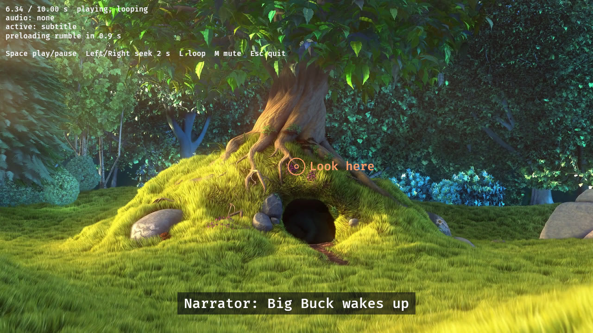
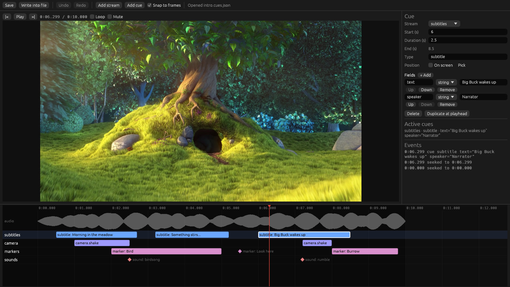
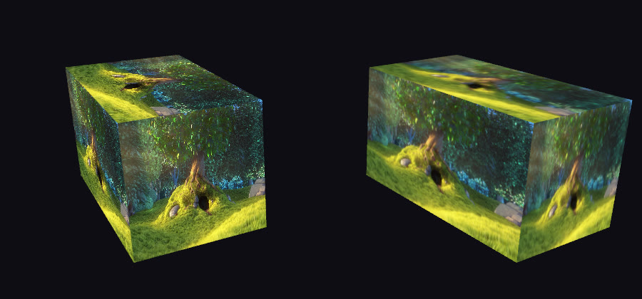
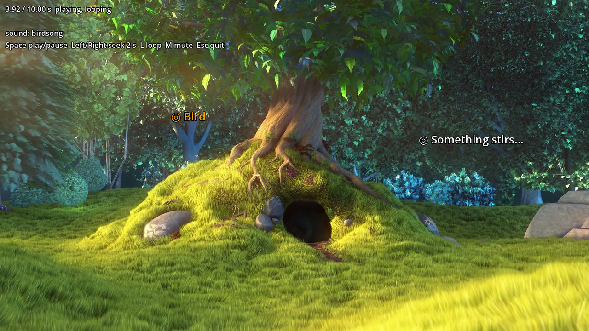

# praxi

**A video codec and player for games, in pure Rust.** Named after the praxinoscope, the
19th-century animation device.

Frames are stored as GPU block-compressed textures (BC7, BC1, ASTC), or in a motion codec
the GPU decodes. Playback is a light decompress and a texture upload: no YUV conversion,
no per-pixel CPU work, nothing allocated per frame and no threads spawned. Videos carry
multi-channel audio and **timed cues** (subtitles, markers, camera shakes, anything your
game defines) that the player emits as events, in step with what is heard.



*The `cue_game` example in Bevy: the subtitle, the "Look here" marker, camera shakes and
sounds all come from cues stored in the video file.*

## Features

- **Cheap decode.** A 1080p frame decodes in 0.6-1.5 ms on one laptop CPU core and stays
  compressed in VRAM. The motion codec decodes on the GPU and reaches BC7's quality at
  about a sixth of its size.
- **One file for every platform.** A video can hold several texture formats (BC7 or BC1
  for desktop, ASTC for mobile, BC6H and ASTC HDR for HDR); the player picks the one the
  GPU supports.
- **HDR.** BC6H and ASTC HDR variants decode to linear floats for HDR rendering, bloom
  and emissive screens; PQ, HLG and OpenEXR sources, with SDR variants tonemapped from them.
- **Alpha.** Straight alpha for videos composited over the game.
- **Seamless.** Fast seeking, gapless looping, several videos and several tracks at once.
- **Audio.** PCM, IMA ADPCM and Opus tracks in any channel layout, handed to your mixer
  from any thread, with the video clock following the audio so lips and sound stay in sync.
- **Cues.** Typed, timed events stored in the file, parsed into your own enum with serde,
  with screen positions, "what is active now" and "what starts soon" queries for preloading.
  Edit them after encoding without re-encoding the video.
- **Tools.** A command line encoder, a GPU viewer and a timeline cue editor.
- **Engines.** A Bevy plugin, a Godot addon and a `wgpu` integration.



*`praxi-editor`: cue streams on a timeline over the audio waveform, an inspector for the
selected cue, and live preview. Saves a cue sheet or writes the cues straight into the
playing file.*



*The `video_box` example in Bevy: the video as the texture of rotated 3D boxes, without
mipmaps on the left and with them on the right.*

## Crates

| Crate | |
|---|---|
| [`praxi`](crates/praxi) | The player library: open a file, advance it every frame, read events, frames and audio |
| [`praxi-bevy`](crates/praxi-bevy) | Bevy 0.20 plugin: video into an `Image`, audio, events and cues as observable events |
| [`praxi-godot`](crates/praxi-godot) | Godot 4.4+ addon: `.praxi` files in `VideoStreamPlayer`, cues as signals (from GDScript, C# or C++) |
| [`praxi-wgpu`](crates/praxi-wgpu) | Texture upload and drawing for engines on `wgpu` 30 |
| [`praxi-encoder`](crates/praxi-encoder) | Encoder library: RGBA frames, audio and cues to `.praxi` |
| [`praxi-format`](crates/praxi-format) | Container reader and writer, cue sheets |
| [`praxi-audio`](crates/praxi-audio) | Audio output through `cpal`, for tools |
| [`praxi-cli`](crates/praxi-cli) | Binary **`praxi`**: encode, inspect, export frames, edit cues |
| [`praxi-viewer`](crates/praxi-viewer) | Binary **`praxi-viewer`**: plays files on the GPU, takes screenshots |
| [`praxi-editor`](crates/praxi-editor) | Binary **`praxi-editor`**: the cue timeline editor |

## Install

Download `praxi`, `praxi-viewer` and `praxi-editor` for Linux x86_64, macOS Apple Silicon
or Windows x64 from [Releases](https://github.com/qbart/praxi/releases). The macOS
binaries are not signed: run `xattr -d com.apple.quarantine praxi*` after unpacking.

Or build them with cargo:

```sh
cargo install praxi-cli praxi-viewer praxi-editor
```

Encoding needs `ffmpeg` and `ffprobe` on `PATH`. On Linux, the viewer, the editor and
`praxi-bevy`'s audio need the ALSA headers (`libasound2-dev` on Debian and Ubuntu).

From a checkout: `make build` puts all three binaries in `target/release/`.

## Quick start

Encode any video ffmpeg reads, with two texture formats, Opus audio and a cue:

```sh
praxi encode input.mp4 -o intro.praxi --variant bc7 --variant astc6x6 --audio-format opus \
    --cue "2.5=camera.shake:strength=0.8"
praxi info intro.praxi
```

For a BC7 and Opus file, `praxi info` prints:

```
version   0.11
duration  10.000 s
stream 0  group 0  time base 1/60  600 chunks  video BC7 1280x720 sRGB
stream 1  group 0  time base 1/48000  101 chunks  audio "main" 48000 Hz 2 ch mask 0x0 opus preload 250 ms
```

Watch it (Space pauses, arrows seek, L loops, M mutes, Q quits):

```sh
praxi-viewer intro.praxi
praxi-viewer intro.praxi --screenshot frame.png --at 2.5
```

Write cues in the editor, or as JSON, then store them in the file without re-encoding:

```sh
praxi cues export intro.praxi -o intro.cues.json
praxi cues srt subtitles.en.srt --field lang=en -o subs.en.json   # subtitles from SRT
praxi-editor intro.praxi intro.cues.json                          # timeline editor
praxi-viewer intro.praxi --cues intro.cues.json                   # live preview, reloads on save
praxi cues import intro.praxi intro.cues.json subs.en.json -o intro.praxi
```

## In a Bevy game

```toml
[dependencies]
praxi-bevy = "0.2"
```

```rust
use bevy::prelude::*;
use bevy::render::renderer::RenderAdapter;
use praxi_bevy::{PraxiAudio, PraxiAudioPlugin, PraxiCue, PraxiCuePlugin, PraxiPlugin, PraxiVideo};

#[derive(serde::Deserialize, Clone)]
enum GameCue {
    #[serde(rename = "camera.shake")]
    Shake { strength: f32 },
    #[serde(rename = "subtitle")]
    Subtitle { text: String },
}

fn main() {
    App::new()
        .add_plugins((DefaultPlugins, PraxiPlugin, PraxiCuePlugin::<GameCue>::default(), PraxiAudioPlugin))
        .add_systems(Startup, setup)
        .run();
}

fn setup(mut commands: Commands, adapter: Res<RenderAdapter>, mut images: ResMut<Assets<Image>>) {
    commands.spawn(Camera2d);
    let mut video = PraxiVideo::open("intro.praxi".as_ref(), &adapter, &mut images).unwrap();
    video.player().play().unwrap();
    commands
        .spawn((Sprite::from_image(video.image.clone()), video, PraxiAudio::default()))
        .observe(|cue: On<PraxiCue<GameCue>>| {
            // Runs in the frame the cue is heard.
            if let GameCue::Shake { strength } = cue.cue { info!("shake {strength}") }
        });
}
```

The video's image works anywhere an image does: sprites, UI, materials, egui. On a 3D
mesh it is just a material texture, at any rotation:

```rust
let material = materials.add(StandardMaterial { base_color_texture: Some(video.image.clone()), unlit: true, ..default() });
commands.spawn((Mesh3d(meshes.add(Rectangle::new(1.6, 0.9))), MeshMaterial3d(material), Transform::from_rotation(Quat::from_rotation_y(0.6))));
```

For video seen small or at an angle in 3D, open it with
`PraxiVideo::open_with(.., PraxiVideoOptions { mipmaps: true })` to get mipmaps (off by
default; or encode a smaller variant for far away).

Try the examples from a checkout:

```sh
make cue-game                                                        # the cutscene above
make video-box                                                       # a test pattern on spinning boxes, with and without mipmaps
make video-box-bunny                                                 # the same with Big Buck Bunny (the box screenshot above)
cargo run --release -p praxi-bevy --example cue_editor -- intro.praxi   # a Bevy + egui cue editor
```

## In Godot

Download `praxi-godot-vX.Y.Z.zip` from [Releases](https://github.com/qbart/praxi/releases)
and copy its `addons/praxi/` into your project (Godot 4.4 or newer). `.praxi` files then
play in the built-in `VideoStreamPlayer`:

```gdscript
func _ready():
    var stream: VideoStreamPraxi = load("res://intro.praxi")
    stream.looping = true                       # seamless
    stream.cue.connect(_on_cue)
    $VideoStreamPlayer.stream = stream
    $VideoStreamPlayer.play()

func _on_cue(id, type, fields, time, duration, position):
    if type == "camera.shake":
        $Camera2D.shake(fields.strength)
```

`stream.active_cues()` and `stream.upcoming_cues(seconds)` answer what is on now and what
starts soon. Godot shows BC7, BC1, ASTC 4x4 and ASTC 8x8 variants. The example project
(`make godot-example`) is the cue game above in Godot:



## In any engine

The `praxi` crate has no engine or GPU dependency. You advance it with your frame time and
upload what it hands out (`features = ["serde"]` for `cue.parse`):

```rust
let caps = praxi::Capabilities::new([praxi::TextureFormat::Bc7]).max_audio_channels(2);
let mut player = praxi::Player::open(std::fs::File::open("intro.praxi")?, &caps)?;
let audio = player.audio_output(0).unwrap(); // Send + Sync: read it from the audio callback
player.play()?;
// every game frame:
player.advance(dt)?;
while let Some(event) = player.poll_event() {
    // Started, Cue, CueEnd, Looped, Seeked, Finished, ...
    if let praxi::Event::Cue(cue) = &event {
        if let Ok(GameCue::Shake { strength }) = cue.parse::<GameCue>() { shake(strength) }
    }
}
if let Some(frame) = player.video_frame(0) { /* upload frame.data as a compressed texture */ }
```

Engines on `wgpu` get the upload, GPU motion decoding and drawing from `praxi-wgpu`; see
the `cutscene` example and [engine-integration.md](docs/features/engine-integration.md).

## Numbers

Big Buck Bunny, 1080p60 (`make bench`, first 3 s):

| Variant | Size | PSNR |
|---|---|---|
| BC7 | 54.6 MB/s | 41.1 dB |
| BC1 | 24.0 MB/s | 36.2 dB |
| ASTC 6x6 | 34.1 MB/s | 37.4 dB |
| ASTC 8x8 | 18.4 MB/s | 34.0 dB |
| motion, `qp` 16 | 8.9 MB/s | 41.1 dB |

Block formats decode in 0.6-1.5 ms per frame on one core of an AMD Ryzen AI 9 HX 370
(laptop, Linux); `praxi bench` records the machine with its results. praxi trades file size for
decode cost; it does not compete with H.264 or AV1 on size
([overview.md](docs/features/overview.md#non-goals)).

## Docs

- Features and design: [docs/features/](docs/features/), starting with
  [overview.md](docs/features/overview.md)
- File format: [docs/spec/PRAXI.md](docs/spec/PRAXI.md) (version 0.11), cue sheets:
  [docs/spec/CUESHEET.md](docs/spec/CUESHEET.md)
- Tests and checks: [testing.md](docs/features/testing.md) (`make check`)
- Releasing: [releasing.md](docs/features/releasing.md)
- Roadmap: [ROADMAP.md](ROADMAP.md)

## License

Licensed under either of [Apache License 2.0](LICENSE-APACHE) or [MIT](LICENSE-MIT), at
your option.

Screenshots show [Big Buck Bunny](https://peach.blender.org), © Blender Foundation,
licensed under CC BY 3.0.
