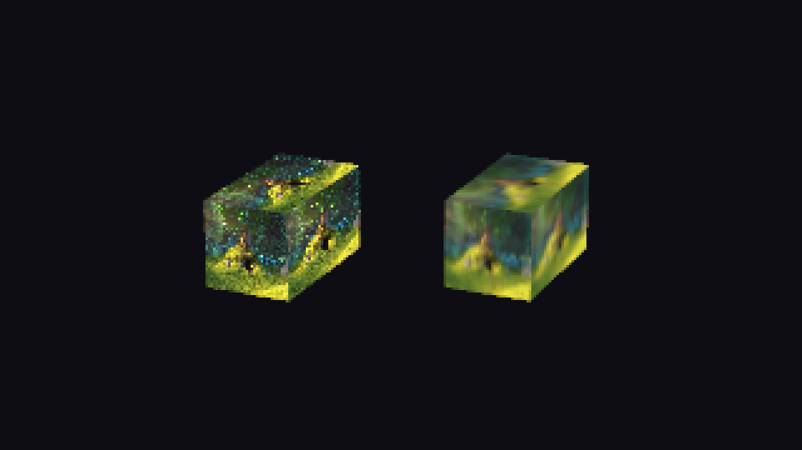

# Bevy

`praxi-bevy` plays praxi files in [Bevy](https://bevyengine.org) 0.20 on top of
`praxi-wgpu` ([engine-integration.md](engine-integration.md)). Bevy 0.20 uses `wgpu` 30, the
version `praxi-wgpu` is built on, so the video is drawn with Bevy's own device. An example
cue editor built with `bevy_egui` shows the plugin in a tool.

## Plugin

```rust
App::new()
    .add_plugins((DefaultPlugins, praxi_bevy::PraxiPlugin))
    .add_systems(Startup, |mut commands: Commands, adapter: Res<RenderAdapter>, mut images: ResMut<Assets<Image>>| {
        let video = praxi_bevy::PraxiVideo::open("intro.praxi".as_ref(), &adapter, &mut images).unwrap();
        commands.spawn(Sprite::from_image(video.image.clone()));
        commands.spawn(video);
    })
```

- `PraxiVideo` (component) owns a `Player` on a file, the `praxi-wgpu` renderer and an
  `Image` asset (`image`, `Rgba8UnormSrgb`, the size of video track 0) that shows the
  video. The image can be used like any other: on a sprite, in UI, as a material texture,
  or in egui through `bevy_egui`'s user textures.
- `PraxiVideo::open(path, adapter, images)` opens the file with the texture formats the
  adapter supports (`praxi_wgpu::capabilities`). Bevy requests every feature and limit
  of the adapter by default, which includes BC, ASTC and what the motion decoder needs.
  It starts paused at the first frame.
- `PraxiVideo::player()` gives the player: play, pause, seek, loop, cue streams,
  `replace_cues` and the rest of the player API ([player.md](player.md)).
- Every `Update`, the plugin advances each video's player by Bevy's `Time` delta and
  sends each player event as a `PraxiEvent { entity, event }` message, in the system set
  `PraxiSystems::Advance`. Read them with `MessageReader<PraxiEvent>`, or observe them as
  they happen ([below](#cues-as-they-happen)).
- `PraxiCuePlugin::<T>` also sends cues parsed into a game type as `PraxiCue<T>` messages
  (`PraxiSystems::Cues`), and `position_on_sprite` / `position_in_rect` map cue positions
  to where the video is shown ([cue-runtime.md](cue-runtime.md)). The `cue_game` example
  consumes cues in a small game ([cue-runtime.md](cue-runtime.md#example-game)).
- In `PostUpdate`, the plugin uploads new frames (`VideoRenderer::prepare`) and draws video
  track 0 and the tracks blended over it into the video's own `Rgba8UnormSrgb` texture,
  through Bevy's `RenderDevice` and `RenderQueue`, which Bevy also puts in the main world.
- In the render world, before the frame is drawn, the plugin copies that texture into the
  `Image`'s GPU texture when a new frame was drawn. The copy stays on the GPU. The image
  asset is `RENDER_WORLD` only, so the main world keeps no pixels.
- Audio plays through Bevy's audio with `PraxiAudioPlugin` and a `PraxiAudio` component
  ([below](#audio)). Without them the player's clock runs on Bevy's time and nothing is
  heard.
- `PraxiVideo::release_file()` closes the player's file, so that the file can be replaced
  (for example by writing cues into it), and `PraxiVideo::reopen()` opens it again at the
  same position, play state and loop setting, as the editor does
  ([cue-editor.md](cue-editor.md#saving)).

The player is not `Sync`, so the component holds it in a `SyncCell`: systems that query
`&mut PraxiVideo` get it; `&PraxiVideo` cannot reach it.

## Mipmaps

A video shown small or at an angle in 3D (a screen across a room, a box seen from afar)
shimmers without mipmaps. They are off by default: each new frame would cost a few more
GPU passes, and a game can instead encode a smaller variant or a second, smaller file and
pick what to show by distance. A video opts in when it is opened:

```rust
let options = PraxiVideoOptions { mipmaps: true, ..Default::default() };
let video = PraxiVideo::open_with(path, &adapter, &mut images, options)?;
```

- `PraxiVideo::open(path, adapter, images)` is `open_with` with
  `PraxiVideoOptions::default()` (`mipmaps: false`): the image has one mip level, as
  before.
- With `mipmaps`, the image has the full chain (`floor(log2(max(width, height))) + 1`
  levels), `RENDER_ATTACHMENT` usage, and a trilinear sampler (linear min, mag and mipmap
  filters; `ImageSamplerDescriptor::linear`).
- In the render world, right after a new frame is copied into the image's level 0, each
  level is drawn from the one above it: a full-screen triangle sampling the level above
  with a linear filter, one render pass per level, in the same command buffer as the
  copy. The image is `Rgba8UnormSrgb`, so filtering happens on linear values. Nothing is
  done for display frames without a new video frame.
- Cost: the levels add a third of the frame's pixels, drawn once per new video frame (the
  video's frame rate, not the display's).

## Cues as they happen

`PraxiEvent` and `PraxiCue<T>` are also entity events on the video's entity, triggered when
the player emits them, besides being sent as messages:

```rust
commands.spawn((video, PraxiAudio::default())).observe(|cue: On<PraxiCue<GameCue>>, mut shake: ResMut<Shake>| {
    if let GameCue::Shake { strength } = cue.cue { shake.start(strength) }
});
app.add_observer(|e: On<PraxiEvent>| { /* every event of every video */ });
```

- Observers run as soon as the system that triggered them ends: `PraxiEvent` after
  `PraxiSystems::Advance`, `PraxiCue<T>` after `PraxiSystems::Cues`, before any other
  system that frame and without ordering the game's systems after the plugin's. Messages
  stay for systems that read them in a batch.
- An observer on the video entity (`.observe(...)`) sees that video's events; a global
  observer (`app.add_observer`) sees every video's. Events of one `advance` are triggered
  in the player's order: cue ends before starts at the same time, `Seeked` and `Looped`
  where the player puts them ([cues.md](cues.md#player-behaviour)).
- With [audio](#audio) and its clock, a cue fires in the frame where its time is heard.

## Audio

```rust
app.add_plugins((DefaultPlugins, PraxiPlugin, PraxiAudioPlugin));
commands.spawn((video, PraxiAudio::default()));
```

The `audio` feature (default on) turns on Bevy's `bevy_audio`. Bevy's `AudioPlugin` (in
`DefaultPlugins`) must be added; `PraxiAudioPlugin` registers praxi's audio source with it.

- `PraxiAudio` (component on a `PraxiVideo` entity) plays the video's audio tracks:
  - `volume: f32`: linear gain of every track, default `1.0`; changes apply at once.
  - `clock: bool`, default `true`: the video follows what is heard
    (`Clock::Audio` on track 0, [audio.md](audio.md#audio-master-clock)), so frames and
    cues stay in step with the sound. `false` keeps the clock on Bevy's time, audio
    following it.
  - `latency: Option<Duration>`: how long after a sample is read it is heard. `None`
    (default) estimates it (below).
- Each audio track of the player (`audio_tracks()`) plays from a child entity of the video
  with an `AudioPlayer<PraxiAudioSource>` and a `PraxiAudioTrack { track }` component, so
  despawning the video stops its sound. Tracks the player has disabled
  (`set_audio_track_enabled`) play silence; the player picks layout variants as usual.
- `PraxiAudioSource` is an asset wrapping an `AudioOutput`. Its decoder is a rodio source
  at the track's rate and channel count that reads the output in blocks of 256 frames and
  plays silence when the output has nothing (paused, finished, not decoded yet), so it
  never ends. Bevy's mixer (rodio) converts rate and channels to the device.
- **Latency estimate**: the device pulls samples in bursts, one buffer per callback. The
  source measures a burst as the frames read with less than 2 ms between blocks, and the
  estimate is two bursts (the buffer being played and the one just filled). Bevy does not
  expose the device's timestamps, so this is an estimate; set `latency` when it is known.
- Removing `PraxiAudio` despawns the children and sets `Clock::Game`. `reopen()` gives the
  player new outputs, so the children are replaced.
- Without an audio device Bevy plays nothing and nothing reads the outputs; with `clock`
  the player then runs on Bevy's time ([audio.md](audio.md#audio-master-clock): audio
  behind the clock).
- `praxi-audio` (cpal) is not used: Bevy owns the device.

## Video box example

```sh
cargo run --release -p praxi-bevy --example video_box -- intro.praxi
```

The video on the faces of two spinning boxes in 3D, with an unlit `StandardMaterial`
whose `base_color_texture` is the video's image: no render target beyond the plugin's
own. The left box plays without mipmaps, the right one with them (two `PraxiVideo`s on
the same file), so the shimmering of the left box at a distance shows what mipmaps fix.
Each label shows the box's texture format, its clock and the index of the frame decoded last. Up and Down move the camera away and back, Space pauses, Escape quits. There is no audio.
`make video-box` runs it on the sample (`make cue-game`'s file).



`Cuboid`'s own UVs show the video flipped or sideways on some faces, so the example builds
the box with UVs that keep the video upright on every face: up along y on the sides, the
top and bottom read from the front.

## Cue editor example

```sh
cargo run --release -p praxi-bevy --example cue_editor -- intro.praxi [intro.cues.json]
```

A simple cue editor: the full editor is `praxi-editor` ([cue-editor.md](cue-editor.md)).

- **Top bar**: play/pause, frame back and forward, position and duration, Save cues to JSON (writes the
  sheet), Write cues into .praxi (writes the cues into the file through `release_file`,
  `replace_cues_in_file` and `reopen`), and the last status message.
- **Video** in the middle, letterboxed.
- **Timeline** at the bottom: a ruler and one lane per cue stream. Cues with a duration
  are bars, instantaneous cues are ticks, in their lane's colour from the same palette as
  the full editor ([cue-editor.md](cue-editor.md#window)). Click the ruler to seek, click
  a cue to select it, click an empty lane to select the stream. The playhead is a red
  line.
- **Inspector** on the right: the selected cue's start, duration, type and string fields
  (add, edit, remove), Delete, and "Set start to playhead". With a stream selected: its
  name, "Add cue at playhead", "Add stream". Below: the last 20 player events.
- **Screen positions**, as in the full editor
  ([cue-editor.md](cue-editor.md#screen-positions)):
  - Inspector: a Position row under Type. "On screen" gives the cue a position at the
    centre (`0.5, 0.5`) or removes `x` and `y`. When on, `x` and `y` are drag values in
    `0..=1` (three decimals), applied when the drag ends or the value loses focus, and
    **Pick** arms the picker. `x` and `y` also stay in the field list, read only.
  - Picker: while armed, the pointer over the video is a crosshair and a click sets the
    selected cue's position to the clicked point (clamped to the video) and disarms it.
    Pick again, Escape or selecting something else disarms it without a change.
  - Markers: every positioned cue active at the playhead (instantaneous cues for 0.5 s after
    their start), and the selected cue at any time, is a dot in its lane's colour with a
    dark outline and a label (type and first string field) on a dark box. The selected
    cue's dot is larger, with a ring.
  - Dragging the selected cue's dot moves it; the position is applied on release. Clicking
    another cue's dot selects that cue.
- Keys: Space plays or pauses, Left and Right step one frame, Delete removes the selected
  cue, Escape disarms the picker, when no text field has focus.
- The sheet is `FILE` with the extension `.cues.json` unless given. If it exists, the
  editor starts from it, otherwise from the cues in the file. Every edit plays back at once
  through `replace_cues`. There is no undo.
- Field values are edited as strings. Fields of other types are shown and kept, but not
  editable.

## Tests

`PraxiAudioSource` is tested without a device: its decoder returns the samples of the
output in order at the track's rate and channel count, silence while paused, and never
ends. The headless app test below also checks that `PraxiAudio` spawns one child per
audio track and sets the audio clock, that removing it restores `Clock::Game`, and that
global and entity observers see `PraxiEvent` and `PraxiCue<T>`.

`praxi-bevy` has a headless test that runs the plugin in a Bevy app without a window
(`MinimalPlugins`, `WindowPlugin` with no primary window, `AssetPlugin`, `RenderPlugin`,
`ImagePlugin`, `MeshPlugin`) when an adapter is available. For a motion clip, and a BC7
clip when the adapter samples BC, it plays for ten updates of 50 ms and checks that frames
were drawn, the latest drawn frame was copied into the image's GPU texture and the clip's
cue arrived as a `PraxiEvent` and, through `PraxiCuePlugin`, as one `PraxiCue<T>` of an
enum `T`. The copied pixels are not read back. A second test opens a BC7 clip with
`mipmaps` (when the adapter samples BC) and checks that the image has the full chain of
levels and that the smallest level, read back after a few updates, is opaque (alpha above 240; BC7 rounds it) and not black: the chain
was drawn from the frames, not left uninitialized. Without an adapter it
skips, as the other GPU tests do ([testing.md](testing.md)).

The editor example is a manual check. It also runs under Xvfb on lavapipe:
`Xvfb :77 &`, then `DISPLAY=:77 cue_editor FILE`, with `xdotool` for input (`xdotool
windowfocus` first, since there is no window manager to give the window keyboard focus)
and `ffmpeg -f x11grab` for screenshots. Selecting, playing, editing a type, deleting,
Save cues to JSON and Write cues into .praxi were checked that way, and so were positions: turning one on,
picking, dragging a marker, selecting a cue by its marker and saving the position to the
sheet.
